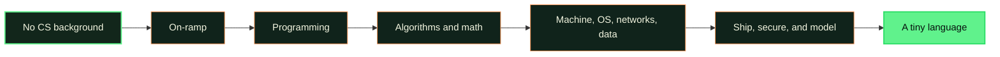

# CS-Geni

[Start learning with CS-Geni](https://cs-geni.github.io/public/).

CS-Geni is a free learning platform for people starting with no computer science background. The site is a staged path of 12 tracks and 15 courses: visual explanations, practice, projects, and progress saved in the browser. This repository is the website. The study map, the labs, and the capstone briefs live beside it.

## Start here

| You want to | Go to |
| --- | --- |
| Take a lesson | [cs-geni.github.io/public](https://cs-geni.github.io/public/) |
| See the whole path on one page | [CS-Geni/curriculum](https://github.com/CS-Geni/curriculum) |
| Run a small program and its tests | [CS-Geni/labs](https://github.com/CS-Geni/labs) |
| Read a capstone before you build it | [CS-Geni/projects](https://github.com/CS-Geni/projects) |
| Try the original three demos | [Showcase](https://cs-geni.github.io/public/showcase/) |

About 482 hours and 145 lessons are mapped in the curriculum. Hours are a plan, not a deadline.

## The path

| Step | Course | Track | Hours |
| --- | --- | --- | --- |
| 1 | [Computer Science Without the Jargon](https://github.com/CS-Geni/curriculum/blob/main/courses/computer-thinking.md) | Start from zero | 8h |
| 2 | [Python: Your First Programs](https://github.com/CS-Geni/curriculum/blob/main/courses/python-first-steps.md) | Programming foundations | 24h |
| 3 | [Designing Reliable Programs](https://github.com/CS-Geni/curriculum/blob/main/courses/program-design.md) | Programming foundations | 28h |
| 4 | [Data Structures in Practice](https://github.com/CS-Geni/curriculum/blob/main/courses/data-structures.md) | Data structures & algorithms | 34h |
| 5 | [Algorithmic Problem Solving](https://github.com/CS-Geni/curriculum/blob/main/courses/algorithmic-thinking.md) | Data structures & algorithms | 42h |
| 6 | [Discrete Math for Builders](https://github.com/CS-Geni/curriculum/blob/main/courses/discrete-math.md) | Math for computer science | 36h |
| 7 | [Inside a Computer](https://github.com/CS-Geni/curriculum/blob/main/courses/inside-computers.md) | Systems & architecture | 38h |
| 8 | [How Operating Systems Work](https://github.com/CS-Geni/curriculum/blob/main/courses/operating-systems.md) | Operating systems | 46h |
| 9 | [Networks from First Principles](https://github.com/CS-Geni/curriculum/blob/main/courses/computer-networks.md) | Networks & distributed systems | 36h |
| 10 | [Databases That Make Sense](https://github.com/CS-Geni/curriculum/blob/main/courses/database-design.md) | Databases | 30h |
| 11 | [Git & Collaborative Development](https://github.com/CS-Geni/curriculum/blob/main/courses/git-collaboration.md) | Software engineering & DevOps | 12h |
| 12 | [Shipping & Operating Software](https://github.com/CS-Geni/curriculum/blob/main/courses/shipping-software.md) | Software engineering & DevOps | 26h |
| 13 | [Secure by Design](https://github.com/CS-Geni/curriculum/blob/main/courses/secure-by-design.md) | Security | 30h |
| 14 | [Data & AI Foundations](https://github.com/CS-Geni/curriculum/blob/main/courses/data-ai-foundations.md) | AI & data | 40h |
| 15 | [Build Your Own Language](https://github.com/CS-Geni/curriculum/blob/main/courses/crafting-language.md) | Advanced electives | 52h |

Each course page lists outcomes, modules, the capstone, and the books to read beside it. The books stay on their authors' sites.

## What is in this repository

- The compiled learning site in `index.html` and `assets/`
- The original showcase in `showcase/`
- A check that the showcase script parses and its demo behavior holds: `npm run check`

The application source, API, account system, and lesson scripts stay in the private `CS-Geni/codebase` repository. This repository does not contain server code, learner data, credentials, or production configuration.

### How the site is published

The pages are built from private `CS-Geni/codebase` `main` with `VITE_BASE_PATH=/public/` and `VITE_STATIC_DEPLOYMENT=true`. Only the compiled site is committed here. GitHub Pages serves it at [cs-geni.github.io/public](https://cs-geni.github.io/public/).

## Contributing

Issues and pull requests that improve clarity, accessibility, or the showcase are welcome.

| Change | Send it to |
| --- | --- |
| Showcase, page text, or this README | This repository |
| A course outcome, module, or book link | [curriculum](https://github.com/CS-Geni/curriculum) |
| A lab | [labs](https://github.com/CS-Geni/labs) |
| A capstone checklist | [projects](https://github.com/CS-Geni/projects) |

Run `npm run check` before opening a pull request here. Keep the change small enough to review, and write it for a beginner.

## Privacy and security

Do not commit secrets, credentials, personal learner data, private lesson scripts, production configuration, or code copied from private CS-Geni systems. Treat every commit, issue, build log, and pull request here as public.

## License

Original code in this repository is [MIT](LICENSE). Linked books keep the license printed on their own sites.
